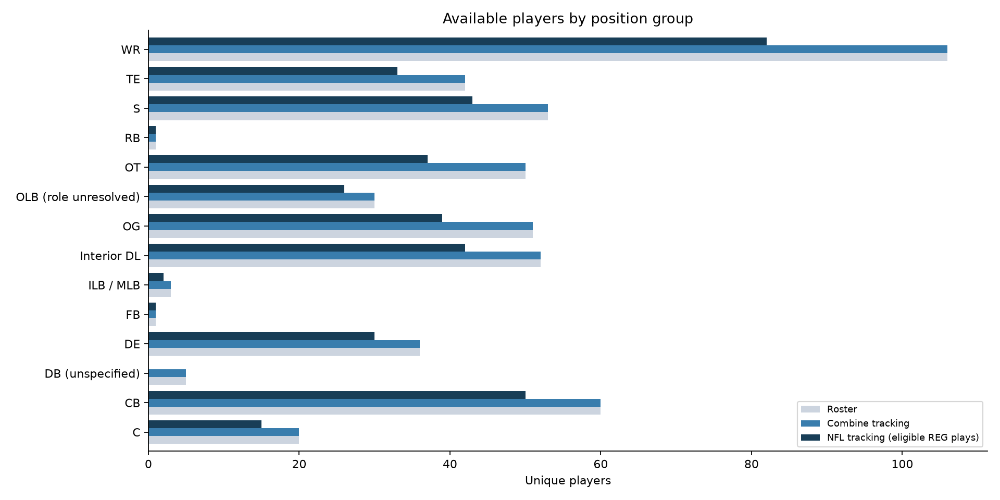

# Position-by-position exploratory audit

This report inventories every represented position group without selecting a competition question. Counts and summaries come from the nine local CSVs.

## Scope and definitions

The roster contains 510 players. No QB is present. The schedule contains preseason, regular-season and postseason games. Unless explicitly labeled otherwise, NFL tables below include only REG games and player-play rows with play_nullified_by_penalty = N. Missing outcomes are not converted to zero. OLB and unspecified DB remain separate groups.

The report measures availability and descriptive distributions. It does not yet estimate predictive relationships or identify the best research question. Whole-attempt speed summaries include setup and recovery frames, and should not be interpreted as segmented drill performance.

## Coverage across groups

| group | players | 2023 | 2024 | 2025 | combine_tracking_players | drill_attempts | regular_season_players | regular_season_player_plays | rookie_regular_season_players | tracked_regular_season_players | tracked_regular_season_player_plays | plays_with_snap_tag |
|---|---|---|---|---|---|---|---|---|---|---|---|---|
| C | 20 | 7 | 10 | 3 | 20 | 206 | 15 | 10649 | 12 | 15 | 10649 | 10617 |
| CB | 60 | 15 | 28 | 17 | 60 | 710 | 50 | 34760 | 46 | 50 | 34759 | 34686 |
| DB (unspecified) | 5 | 0 | 1 | 4 | 5 | 54 | 0 | 0 | 0 | 0 | 0 | 0 |
| DE | 36 | 15 | 12 | 9 | 36 | 464 | 30 | 17493 | 29 | 30 | 17493 | 17443 |
| FB | 1 | 0 | 0 | 1 | 1 | 15 | 1 | 31 | 1 | 1 | 29 | 29 |
| ILB / MLB | 3 | 0 | 2 | 1 | 3 | 37 | 2 | 420 | 2 | 2 | 420 | 420 |
| Interior DL | 52 | 11 | 18 | 23 | 52 | 482 | 42 | 16316 | 40 | 42 | 16316 | 16250 |
| OG | 51 | 17 | 15 | 19 | 51 | 523 | 39 | 37470 | 39 | 39 | 37470 | 37361 |
| OLB (role unresolved) | 30 | 11 | 7 | 12 | 30 | 379 | 26 | 16598 | 25 | 26 | 16598 | 16562 |
| OT | 50 | 13 | 21 | 16 | 50 | 485 | 37 | 34729 | 33 | 37 | 34729 | 34587 |
| RB | 1 | 0 | 1 | 0 | 1 | 12 | 1 | 26 | 1 | 1 | 26 | 26 |
| S | 53 | 20 | 18 | 15 | 53 | 619 | 43 | 28789 | 38 | 43 | 28789 | 28713 |
| TE | 42 | 13 | 13 | 16 | 42 | 571 | 33 | 8242 | 33 | 33 | 8006 | 8004 |
| WR | 106 | 38 | 31 | 37 | 106 | 1753 | 82 | 34889 | 79 | 82 | 34818 | 34807 |

## Traditional testing: players with recorded values

| group | forty | ten_yd_split | vertical | broad_jump | three_cone | short_shuttle | bench_reps |
|---|---|---|---|---|---|---|---|
| C | 16 | 16 | 16 | 15 | 13 | 14 | 11 |
| CB | 52 | 52 | 50 | 45 | 14 | 20 | 18 |
| DB (unspecified) | 3 | 3 | 5 | 5 | 0 | 0 | 0 |
| DE | 30 | 30 | 33 | 30 | 15 | 15 | 23 |
| FB | 1 | 1 | 1 | 1 | 1 | 1 | 1 |
| ILB / MLB | 2 | 2 | 2 | 2 | 1 | 1 | 1 |
| Interior DL | 41 | 41 | 46 | 44 | 19 | 21 | 19 |
| OG | 40 | 40 | 44 | 44 | 25 | 28 | 22 |
| OLB (role unresolved) | 23 | 23 | 23 | 23 | 9 | 10 | 12 |
| OT | 39 | 40 | 40 | 39 | 23 | 22 | 20 |
| RB | 1 | 1 | 1 | 1 | 0 | 0 | 1 |
| S | 46 | 46 | 47 | 45 | 10 | 12 | 25 |
| TE | 34 | 34 | 35 | 35 | 18 | 19 | 11 |
| WR | 96 | 96 | 95 | 94 | 32 | 38 | 28 |

## File and measurement findings

- Player-play records: 314,197; duplicate player-play keys: 0.

- Player-play season types: {'REG': 249269, 'PRE': 51759, 'POST': 13169}.

- Combine entity counts: {'PLAYER': 431094, 'BALL': 32095}. Only PLAYER frames enter the drill summaries.

- Duplicate Combine player-frame keys: 0; median positive interval: 0.100 seconds; gaps above 0.15 seconds: 0.

- Negative Combine acceleration values: 0. Do not assume the supplied a field encodes signed braking. Attempt summaries derive signed speed change only across 0.05–0.15 second intervals; these derivatives remain noise-sensitive.

- Separation observations by target flag: {'False': 29992, 'True': 7843}.

- Entirely missing player-play columns: none.

- Game tracking is scanned in full. Its frame counts, season types, event tags and unmatched identifiers are recorded in audit_checks.json. A snap tag confirms an anchor exists, not that an entire play is complete.

- Career totals combine different exposure windows and are not used to rank prospects. The rookie-season coverage column identifies players with eligible records in their draft year.

## C

Original roster labels: {'C': 20}. Keep centers separate initially; inspect whether the same drill definitions and protection responsibilities apply across years.

### Available drills

| drill_type | drill_name | players | attempts | median_duration_s | median_attempt_p95_speed |
|---|---|---|---|---|---|
| SKILL_DRILLS_OL | PASS_RUSH_DROP | 20 | 40 | 4.4 | 5.77 |
| SKILL_DRILLS_OL | FIVE_YARD_WAVE_DRILL_SLIDE_AND_SHUFFLE | 20 | 20 | 15.75 | 7.17 |
| SKILL_DRILLS_OL | SCREEN_DRILL | 20 | 20 | 6.5 | 6.97 |
| SKILL_DRILLS_OL | OL_PULL_DRILL_FOLD_BLOCK_RIGHT | 19 | 19 | 3.7 | 7.0 |
| SKILL_DRILLS_OL | OL_PULL_DRILL_DEEP_SHORT_PULL_LEFT | 17 | 17 | 4.0 | 7.85 |
| FORTY_YARD_DASH | FORTY_YARD_DASH | 16 | 30 | 5.35 | 9.49 |
| SKILL_DRILLS_OL | OL_PULL_DRILL_LONG_PULL_RIGHT | 14 | 14 | 4.95 | 7.04 |
| SKILL_DRILLS_OL | PASS_PRO-MIRROR_DRILL | 13 | 13 | 8.6 | 5.18 |
| SHORT_SHUTTLE | SHORT_SHUTTLE | 11 | 14 | 5.0 | 5.23 |
| THREE_CONE_DRILL | THREE_CONE_DRILL | 11 | 12 | 7.95 | 6.0 |
| SKILL_DRILLS_OL | PASS_PRO_MIRROR_DRILL | 7 | 7 | 8.4 | 4.85 |

### NFL outcome availability

| metric | nonmissing_rows | players | nonmissing_pct | unique_values |
|---|---|---|---|---|
| route_ran | 2 | 1 | 0.02 | 1 |
| separation_at_pass_forward | 2 | 1 | 0.02 | 2 |
| yards_after_catch | 1 | 1 | 0.01 | 1 |
| pressure_allowed | 6293 | 15 | 59.09 | 2 |
| peak_pressure_probability_allowed | 5935 | 15 | 55.73 | 1035 |
| time_to_pressure_allowed | 379 | 14 | 3.56 | 51 |
| tackle | 7 | 5 | 0.07 | 2 |

Availability counts are not success rates. Populated zero values may be defaults outside a metric’s relevant role; eligibility must be established before modeling.

### Game alignments

| lined_up_position | player_plays | players |
|---|---|---|
| C | 9874 | 12 |
| G | 695 | 11 |
| TE | 61 | 4 |
| FB | 19 | 3 |

## CB

Original roster labels: {'CB': 60}. Backpedal and transition drills can be compared with game movement. Coverage assignments exist, but receiver separation is not a direct CB outcome and full opponent tracking is not guaranteed.

### Available drills

| drill_type | drill_name | players | attempts | median_duration_s | median_attempt_p95_speed |
|---|---|---|---|---|---|
| SKILL_DRILLS_DB | BACK_PEDAL_AND_TRANSITION_45_DEGREE_REACTION | 60 | 119 | 9.4 | 9.06 |
| SKILL_DRILLS_DB | BACK_PEDAL_AND_90_DEGREE_BREAK_TO_BALL | 60 | 61 | 6.5 | 8.03 |
| SKILL_DRILLS_DB | BOX_DRILL | 60 | 61 | 7.5 | 7.22 |
| SKILL_DRILLS_DB | W_DRILL | 60 | 61 | 8.1 | 8.04 |
| SKILL_DRILLS_DB | GAUNTLET_DRILL | 59 | 61 | 10.1 | 8.53 |
| SKILL_DRILLS_DB | TERYL_AUSTIN_DRILL_1 | 58 | 59 | 7.5 | 7.9 |
| SKILL_DRILLS_DB | TERYL_AUSTIN_DRILL_2 | 53 | 54 | 8.4 | 8.33 |
| FORTY_YARD_DASH | FORTY_YARD_DASH | 51 | 97 | 4.8 | 11.06 |
| SKILL_DRILLS_DB | LINE_DRILL | 44 | 86 | 6.85 | 7.6 |
| SHORT_SHUTTLE | SHORT_SHUTTLE | 16 | 21 | 4.9 | 5.72 |
| SKILL_DRILLS_DB | LINE | 14 | 14 | 6.9 | 8.28 |
| THREE_CONE_DRILL | THREE_CONE_DRILL | 13 | 16 | 7.3 | 6.45 |

### NFL outcome availability

| metric | nonmissing_rows | players | nonmissing_pct | unique_values |
|---|---|---|---|---|
| player_get_off | 167 | 32 | 0.48 | 154 |
| time_to_pressure | 73 | 22 | 0.21 | 30 |
| quick_pressure | 73 | 22 | 0.21 | 2 |
| unblocked_pressure | 21258 | 49 | 61.16 | 2 |
| tackle | 2846 | 47 | 8.19 | 2 |
| coverage_assignment_at_snap | 21192 | 49 | 60.97 | 20 |

Availability counts are not success rates. Populated zero values may be defaults outside a metric’s relevant role; eligibility must be established before modeling.

### Game alignments

| lined_up_position | player_plays | players |
|---|---|---|
| CB | 26787 | 49 |
| SLOT_CB | 5575 | 45 |
| OLB | 1477 | 43 |
| HIGH_SAFETY | 407 | 30 |
| MLB | 262 | 32 |
| EDGE | 212 | 29 |
| BOX_SAFETY | 28 | 15 |
| INTERIOR_LINE | 12 | 6 |

## DB (unspecified)

Original roster labels: {'DB': 5}. Keep this ambiguous roster label explicit. Use alignments and assignments to establish actual roles before pooling with CB or S.

### Available drills

| drill_type | drill_name | players | attempts | median_duration_s | median_attempt_p95_speed |
|---|---|---|---|---|---|
| SKILL_DRILLS_DB | BACK_PEDAL_AND_TRANSITION_45_DEGREE_REACTION | 5 | 9 | 9.7 | 8.95 |
| SKILL_DRILLS_DB | LINE_DRILL | 5 | 9 | 6.7 | 7.17 |
| SKILL_DRILLS_DB | BACK_PEDAL_AND_90_DEGREE_BREAK_TO_BALL | 5 | 6 | 6.4 | 7.61 |
| SKILL_DRILLS_DB | BOX_DRILL | 5 | 5 | 7.5 | 7.36 |
| SKILL_DRILLS_DB | GAUNTLET_DRILL | 5 | 5 | 10.4 | 8.81 |
| SKILL_DRILLS_DB | TERYL_AUSTIN_DRILL_1 | 5 | 5 | 7.8 | 8.51 |
| SKILL_DRILLS_DB | W_DRILL | 5 | 5 | 8.3 | 7.78 |
| SKILL_DRILLS_DB | TERYL_AUSTIN_DRILL_2 | 4 | 4 | 8.4 | 8.13 |
| FORTY_YARD_DASH | FORTY_YARD_DASH | 3 | 6 | 5.0 | 10.69 |

### NFL outcome availability

No selected outcomes recorded.

Availability counts are not success rates. Populated zero values may be defaults outside a metric’s relevant role; eligibility must be established before modeling.

### Game alignments

| lined_up_position | player_plays | players |
|---|---|---|

## DE

Original roster labels: {'DE': 36}. Inspect hoop and change-of-direction drills where available. Pressure timing is only observed when pressure occurs, so an average among pressures is not an overall rush success measure.

### Available drills

| drill_type | drill_name | players | attempts | median_duration_s | median_attempt_p95_speed |
|---|---|---|---|---|---|
| SKILL_DRILLS_DL | PASS_RUSH_DRILL | 33 | 62 | 4.25 | 7.78 |
| SKILL_DRILLS_DL | RUN_THE_HOOP_DRILL | 33 | 37 | 7.3 | 5.99 |
| SKILL_DRILLS_DL | BODY_CONTROL_DRILL | 33 | 33 | 5.4 | 8.4 |
| SKILL_DRILLS_DL | FOUR_BAG_AGILITY_DRILL | 33 | 33 | 10.6 | 7.34 |
| SKILL_DRILLS_DL | FRONT_START_WAVE_DRILL_AND_LATERAL_REACTION | 33 | 33 | 12.0 | 7.69 |
| SKILL_DRILLS_DL | RUN_AND_CLUB_DRILL | 33 | 33 | 6.7 | 5.62 |
| FORTY_YARD_DASH | FORTY_YARD_DASH | 30 | 57 | 5.1 | 10.4 |
| SKILL_DRILLS_DL | BACK_PEDAL_AND_REACT | 26 | 27 | 10.6 | 6.72 |
| SKILL_DRILLS_DL | SHORT_ZONE_BREAKS | 19 | 59 | 7.1 | 7.26 |
| THREE_CONE_DRILL | THREE_CONE_DRILL | 16 | 25 | 7.6 | 6.11 |
| SHORT_SHUTTLE | SHORT_SHUTTLE | 12 | 16 | 4.95 | 5.42 |
| SKILL_DRILLS_DL | SHORT_ZONE_BREAK_FLAT_WHEEL | 8 | 8 | 11.65 | 8.17 |
| SKILL_DRILLS_DL | SHORT_ZONE_BREAK_FORWARD | 8 | 8 | 5.95 | 6.84 |
| SKILL_DRILLS_DL | SHORT_ZONE_BREAK_INSIDE | 6 | 6 | 8.0 | 7.92 |
| SKILL_DRILLS_LB | SHORT_ZONE_BREAKS | 3 | 10 | 7.35 | 7.8 |
| SKILL_DRILLS_LB | PASS_RUSH_DRILL | 3 | 6 | 4.6 | 8.38 |
| SKILL_DRILLS_LB | BACK_PEDAL_AND_REACT | 3 | 3 | 11.3 | 7.15 |
| SKILL_DRILLS_LB | SHUFFLE_SPRINT_AND_COD_DRILL | 3 | 3 | 9.8 | 6.98 |
| SKILL_DRILLS_LB | WAVE_DRILL | 3 | 3 | 11.8 | 6.7 |
| SKILL_DRILLS_LB | FOUR_BAG_SHUFFLE_DRILL | 2 | 2 | 11.95 | 7.35 |

### NFL outcome availability

| metric | nonmissing_rows | players | nonmissing_pct | unique_values |
|---|---|---|---|---|
| player_get_off | 12580 | 30 | 71.91 | 1450 |
| time_to_pressure | 1028 | 28 | 5.88 | 58 |
| quick_pressure | 1025 | 28 | 5.86 | 2 |
| unblocked_pressure | 10062 | 30 | 57.52 | 2 |
| tackle | 1237 | 29 | 7.07 | 2 |
| coverage_assignment_at_snap | 10029 | 30 | 57.33 | 10 |

Availability counts are not success rates. Populated zero values may be defaults outside a metric’s relevant role; eligibility must be established before modeling.

### Game alignments

| lined_up_position | player_plays | players |
|---|---|---|
| EDGE | 11811 | 30 |
| INTERIOR_LINE | 5605 | 29 |
| MLB | 36 | 8 |
| SLOT_CB | 30 | 11 |
| OLB | 8 | 5 |
| CB | 3 | 3 |

## FB

Original roster labels: {'FB': 1}. Only one roster-listed FB is present. Treat as a case study; inspect route and protection availability separately.

### Available drills

| drill_type | drill_name | players | attempts | median_duration_s | median_attempt_p95_speed |
|---|---|---|---|---|---|
| FORTY_YARD_DASH | FORTY_YARD_DASH | 1 | 2 | 5.2 | 10.12 |
| SKILL_DRILLS_TE | CORNER_ROUTE | 1 | 2 | 7.25 | 8.64 |
| SKILL_DRILLS_TE | GAUNTLET_DRILL | 1 | 2 | 10.35 | 8.44 |
| SHORT_SHUTTLE | SHORT_SHUTTLE | 1 | 1 | 3.5 | 5.17 |
| SKILL_DRILLS_TE | BLOCK_EXPLOSION | 1 | 1 | 4.9 | 2.31 |
| SKILL_DRILLS_TE | END_ZONE_FADE_RIGHT | 1 | 1 | 4.0 | 7.2 |
| SKILL_DRILLS_TE | FLAT_ROUTE_LEFT | 1 | 1 | 4.9 | 7.94 |
| SKILL_DRILLS_TE | HOOK_ROUTE_RIGHT | 1 | 1 | 6.4 | 6.93 |
| SKILL_DRILLS_TE | IN_ROUTE_LEFT | 1 | 1 | 6.4 | 7.53 |
| SKILL_DRILLS_TE | OVER_SHOULDER_ADJUST | 1 | 1 | 6.1 | 8.63 |
| SKILL_DRILLS_TE | WHEEL_ROUTE_LEFT | 1 | 1 | 4.9 | 7.96 |
| THREE_CONE_DRILL | THREE_CONE_DRILL | 1 | 1 | 7.7 | 6.3 |

### NFL outcome availability

| metric | nonmissing_rows | players | nonmissing_pct | unique_values |
|---|---|---|---|---|
| route_ran | 31 | 1 | 100.0 | 8 |
| separation_at_pass_forward | 26 | 1 | 83.87 | 26 |
| pressure_allowed | 1 | 1 | 3.23 | 1 |
| tackle | 2 | 1 | 6.45 | 1 |

Availability counts are not success rates. Populated zero values may be defaults outside a metric’s relevant role; eligibility must be established before modeling.

### Game alignments

| lined_up_position | player_plays | players |
|---|---|---|
| FB | 10 | 1 |
| TE | 10 | 1 |
| WR | 5 | 1 |
| RB | 3 | 1 |
| SLOT_WR | 3 | 1 |

## ILB / MLB

Original roster labels: {'ILB': 2, 'MLB': 1}. The roster sample is very small. Describe individual trajectories and coverage before considering population-level estimates.

### Available drills

| drill_type | drill_name | players | attempts | median_duration_s | median_attempt_p95_speed |
|---|---|---|---|---|---|
| SKILL_DRILLS_DB | BACK_PEDAL_AND_TRANSITION_45_DEGREE_REACTION | 3 | 6 | 6.2 | 8.84 |
| SKILL_DRILLS_DB | LINE_DRILL | 3 | 6 | 6.8 | 7.95 |
| SKILL_DRILLS_DB | BACK_PEDAL_AND_90_DEGREE_BREAK_TO_BALL | 3 | 3 | 6.5 | 8.19 |
| SKILL_DRILLS_DB | BOX_DRILL | 3 | 3 | 7.8 | 6.98 |
| SKILL_DRILLS_DB | GAUNTLET_DRILL | 3 | 3 | 10.2 | 8.66 |
| SKILL_DRILLS_DB | TERYL_AUSTIN_DRILL_1 | 3 | 3 | 7.4 | 8.07 |
| SKILL_DRILLS_DB | TERYL_AUSTIN_DRILL_2 | 3 | 3 | 8.3 | 7.99 |
| SKILL_DRILLS_DB | W_DRILL | 3 | 3 | 8.2 | 7.73 |
| FORTY_YARD_DASH | FORTY_YARD_DASH | 2 | 4 | 4.95 | 10.79 |
| THREE_CONE_DRILL | THREE_CONE_DRILL | 1 | 2 | 7.5 | 5.75 |
| SHORT_SHUTTLE | SHORT_SHUTTLE | 1 | 1 | 4.9 | 5.65 |

### NFL outcome availability

| metric | nonmissing_rows | players | nonmissing_pct | unique_values |
|---|---|---|---|---|
| player_get_off | 32 | 2 | 7.62 | 32 |
| time_to_pressure | 4 | 2 | 0.95 | 4 |
| quick_pressure | 4 | 2 | 0.95 | 2 |
| unblocked_pressure | 185 | 2 | 44.05 | 2 |
| tackle | 73 | 2 | 17.38 | 2 |
| coverage_assignment_at_snap | 185 | 2 | 44.05 | 9 |

Availability counts are not success rates. Populated zero values may be defaults outside a metric’s relevant role; eligibility must be established before modeling.

### Game alignments

| lined_up_position | player_plays | players |
|---|---|---|
| MLB | 190 | 2 |
| OLB | 126 | 2 |
| EDGE | 48 | 2 |
| SLOT_CB | 41 | 2 |
| CB | 7 | 2 |
| INTERIOR_LINE | 7 | 2 |
| HIGH_SAFETY | 1 | 1 |

## Interior DL

Original roster labels: {'DT': 47, 'NT': 5}. Retain DT versus NT labels in deeper work. Compare drills and actual game alignment before combining roles.

### Available drills

| drill_type | drill_name | players | attempts | median_duration_s | median_attempt_p95_speed |
|---|---|---|---|---|---|
| SKILL_DRILLS_DL | PASS_RUSH_DRILL | 52 | 99 | 4.5 | 7.33 |
| SKILL_DRILLS_DL | FOUR_BAG_AGILITY_DRILL | 52 | 52 | 10.3 | 6.77 |
| SKILL_DRILLS_DL | BODY_CONTROL_DRILL | 51 | 53 | 5.6 | 7.79 |
| SKILL_DRILLS_DL | FRONT_START_WAVE_DRILL_AND_LATERAL_REACTION | 50 | 50 | 11.1 | 7.24 |
| SKILL_DRILLS_DL | RUN_AND_CLUB_DRILL | 50 | 50 | 7.35 | 5.17 |
| SKILL_DRILLS_DL | RUN_THE_HOOP_DRILL | 47 | 51 | 7.7 | 5.54 |
| FORTY_YARD_DASH | FORTY_YARD_DASH | 41 | 79 | 5.5 | 9.48 |
| THREE_CONE_DRILL | THREE_CONE_DRILL | 19 | 22 | 7.95 | 6.0 |
| SHORT_SHUTTLE | SHORT_SHUTTLE | 16 | 17 | 5.3 | 5.3 |
| SKILL_DRILLS_DL | SHORT_ZONE_BREAKS | 2 | 6 | 7.65 | 6.94 |
| SKILL_DRILLS_DL | BACK_PEDAL_AND_REACT | 2 | 3 | 10.8 | 6.22 |

### NFL outcome availability

| metric | nonmissing_rows | players | nonmissing_pct | unique_values |
|---|---|---|---|---|
| player_get_off | 9500 | 42 | 58.23 | 1374 |
| time_to_pressure | 610 | 38 | 3.74 | 61 |
| quick_pressure | 606 | 38 | 3.71 | 2 |
| unblocked_pressure | 8935 | 42 | 54.76 | 2 |
| tackle | 1124 | 39 | 6.89 | 2 |
| coverage_assignment_at_snap | 8880 | 42 | 54.43 | 6 |

Availability counts are not success rates. Populated zero values may be defaults outside a metric’s relevant role; eligibility must be established before modeling.

### Game alignments

| lined_up_position | player_plays | players |
|---|---|---|
| INTERIOR_LINE | 15523 | 42 |
| EDGE | 789 | 37 |
| MLB | 2 | 2 |
| SLOT_CB | 1 | 1 |
| TE | 1 | 1 |

## OG

Original roster labels: {'G': 51}. Explore pull drills and short-area transitions. These files do not provide an explicit run-block win outcome.

### Available drills

| drill_type | drill_name | players | attempts | median_duration_s | median_attempt_p95_speed |
|---|---|---|---|---|---|
| SKILL_DRILLS_OL | SCREEN_DRILL | 51 | 52 | 6.6 | 6.84 |
| SKILL_DRILLS_OL | OL_PULL_DRILL_FOLD_BLOCK_RIGHT | 51 | 51 | 3.7 | 7.05 |
| SKILL_DRILLS_OL | PASS_RUSH_DROP | 50 | 99 | 4.3 | 5.68 |
| SKILL_DRILLS_OL | FIVE_YARD_WAVE_DRILL_SLIDE_AND_SHUFFLE | 50 | 50 | 15.1 | 7.19 |
| SKILL_DRILLS_OL | OL_PULL_DRILL_DEEP_SHORT_PULL_LEFT | 44 | 44 | 4.2 | 7.89 |
| SKILL_DRILLS_OL | OL_PULL_DRILL_LONG_PULL_RIGHT | 43 | 43 | 4.9 | 6.84 |
| FORTY_YARD_DASH | FORTY_YARD_DASH | 40 | 76 | 5.6 | 9.29 |
| SKILL_DRILLS_OL | PASS_PRO-MIRROR_DRILL | 34 | 34 | 8.2 | 5.12 |
| SHORT_SHUTTLE | SHORT_SHUTTLE | 25 | 35 | 5.1 | 5.12 |
| THREE_CONE_DRILL | THREE_CONE_DRILL | 20 | 22 | 8.0 | 5.81 |
| SKILL_DRILLS_OL | PASS_PRO_MIRROR_DRILL | 17 | 17 | 8.6 | 4.78 |

### NFL outcome availability

| metric | nonmissing_rows | players | nonmissing_pct | unique_values |
|---|---|---|---|---|
| route_ran | 4 | 4 | 0.01 | 2 |
| separation_at_pass_forward | 4 | 4 | 0.01 | 4 |
| yards_after_catch | 2 | 2 | 0.01 | 2 |
| expected_yards_after_catch | 1 | 1 | 0.0 | 1 |
| pressure_allowed | 21896 | 39 | 58.44 | 2 |
| peak_pressure_probability_allowed | 20843 | 39 | 55.63 | 1453 |
| time_to_pressure_allowed | 1718 | 39 | 4.59 | 67 |
| tackle | 20 | 13 | 0.05 | 2 |

Availability counts are not success rates. Populated zero values may be defaults outside a metric’s relevant role; eligibility must be established before modeling.

### Game alignments

| lined_up_position | player_plays | players |
|---|---|---|
| G | 36064 | 39 |
| C | 954 | 6 |
| T | 295 | 9 |
| TE | 133 | 18 |
| FB | 21 | 3 |
| SLOT_WR | 2 | 2 |
| WR | 1 | 1 |

## OLB (role unresolved)

Original roster labels: {'OLB': 30}. Do not automatically classify OLBs as edge rushers. Use alignment, rush evidence and coverage responsibilities to separate roles at the play level.

### Available drills

| drill_type | drill_name | players | attempts | median_duration_s | median_attempt_p95_speed |
|---|---|---|---|---|---|
| SKILL_DRILLS_DL | PASS_RUSH_DRILL | 29 | 56 | 4.3 | 7.75 |
| SKILL_DRILLS_DL | RUN_THE_HOOP_DRILL | 29 | 31 | 7.3 | 5.94 |
| SKILL_DRILLS_DL | RUN_AND_CLUB_DRILL | 29 | 30 | 6.85 | 5.7 |
| SKILL_DRILLS_DL | FRONT_START_WAVE_DRILL_AND_LATERAL_REACTION | 29 | 29 | 11.1 | 7.77 |
| SKILL_DRILLS_DL | BACK_PEDAL_AND_REACT | 27 | 28 | 10.5 | 6.97 |
| SKILL_DRILLS_DL | BODY_CONTROL_DRILL | 27 | 27 | 5.6 | 8.43 |
| SKILL_DRILLS_DL | FOUR_BAG_AGILITY_DRILL | 27 | 27 | 10.1 | 7.17 |
| FORTY_YARD_DASH | FORTY_YARD_DASH | 22 | 41 | 5.0 | 10.39 |
| SKILL_DRILLS_DL | SHORT_ZONE_BREAKS | 15 | 40 | 7.6 | 7.67 |
| SKILL_DRILLS_DL | SHORT_ZONE_BREAK_FLAT_WHEEL | 12 | 12 | 11.15 | 7.97 |
| SKILL_DRILLS_DL | SHORT_ZONE_BREAK_FORWARD | 12 | 12 | 5.65 | 7.34 |
| SKILL_DRILLS_DL | SHORT_ZONE_BREAK_INSIDE | 12 | 12 | 7.55 | 7.54 |
| THREE_CONE_DRILL | THREE_CONE_DRILL | 10 | 13 | 7.7 | 6.08 |
| SHORT_SHUTTLE | SHORT_SHUTTLE | 10 | 11 | 4.9 | 5.42 |
| SKILL_DRILLS_LB | SHORT_ZONE_BREAKS | 1 | 4 | 8.7 | 7.67 |
| SKILL_DRILLS_LB | PASS_RUSH_DRILL | 1 | 2 | 4.95 | 8.12 |
| SKILL_DRILLS_LB | BACK_PEDAL_AND_REACT | 1 | 1 | 10.5 | 8.15 |
| SKILL_DRILLS_LB | FOUR_BAG_SHUFFLE_DRILL | 1 | 1 | 12.3 | 7.92 |
| SKILL_DRILLS_LB | SHUFFLE_SPRINT_AND_COD_DRILL | 1 | 1 | 9.4 | 7.53 |
| SKILL_DRILLS_LB | WAVE_DRILL | 1 | 1 | 11.7 | 6.92 |

### NFL outcome availability

| metric | nonmissing_rows | players | nonmissing_pct | unique_values |
|---|---|---|---|---|
| player_get_off | 11337 | 26 | 68.3 | 1454 |
| time_to_pressure | 1066 | 24 | 6.42 | 61 |
| quick_pressure | 1064 | 24 | 6.41 | 2 |
| unblocked_pressure | 9973 | 26 | 60.09 | 2 |
| tackle | 1094 | 22 | 6.59 | 2 |
| coverage_assignment_at_snap | 9943 | 26 | 59.9 | 10 |

Availability counts are not success rates. Populated zero values may be defaults outside a metric’s relevant role; eligibility must be established before modeling.

### Game alignments

| lined_up_position | player_plays | players |
|---|---|---|
| EDGE | 15116 | 26 |
| INTERIOR_LINE | 922 | 22 |
| SLOT_CB | 453 | 20 |
| MLB | 41 | 13 |
| OLB | 38 | 12 |
| CB | 28 | 12 |

## OT

Original roster labels: {'T': 50}. Explore lateral and mirror drills alongside protection outcomes. Pressure measures require a defensible pass-protection denominator.

### Available drills

| drill_type | drill_name | players | attempts | median_duration_s | median_attempt_p95_speed |
|---|---|---|---|---|---|
| SKILL_DRILLS_OL | PASS_RUSH_DROP | 50 | 100 | 4.3 | 5.77 |
| SKILL_DRILLS_OL | FIVE_YARD_WAVE_DRILL_SLIDE_AND_SHUFFLE | 50 | 50 | 15.8 | 7.04 |
| SKILL_DRILLS_OL | OL_PULL_DRILL_FOLD_BLOCK_RIGHT | 49 | 49 | 3.6 | 6.99 |
| SKILL_DRILLS_OL | SCREEN_DRILL | 48 | 48 | 6.6 | 6.89 |
| FORTY_YARD_DASH | FORTY_YARD_DASH | 39 | 73 | 5.5 | 9.34 |
| SKILL_DRILLS_OL | OL_PULL_DRILL_DEEP_SHORT_PULL_LEFT | 37 | 37 | 4.4 | 7.9 |
| SKILL_DRILLS_OL | PASS_PRO-MIRROR_DRILL | 37 | 37 | 8.1 | 5.07 |
| SKILL_DRILLS_OL | OL_PULL_DRILL_LONG_PULL_RIGHT | 36 | 36 | 4.85 | 6.82 |
| SHORT_SHUTTLE | SHORT_SHUTTLE | 18 | 21 | 5.2 | 5.05 |
| THREE_CONE_DRILL | THREE_CONE_DRILL | 17 | 21 | 8.0 | 5.75 |
| SKILL_DRILLS_OL | PASS_PRO_MIRROR_DRILL | 13 | 13 | 9.1 | 4.87 |

### NFL outcome availability

| metric | nonmissing_rows | players | nonmissing_pct | unique_values |
|---|---|---|---|---|
| route_ran | 4 | 4 | 0.01 | 3 |
| separation_at_pass_forward | 4 | 4 | 0.01 | 4 |
| yards_after_catch | 1 | 1 | 0.0 | 1 |
| expected_yards_after_catch | 1 | 1 | 0.0 | 1 |
| pressure_allowed | 20508 | 35 | 59.05 | 2 |
| peak_pressure_probability_allowed | 19714 | 35 | 56.77 | 1476 |
| time_to_pressure_allowed | 2004 | 34 | 5.77 | 66 |
| tackle | 11 | 8 | 0.03 | 2 |

Availability counts are not success rates. Populated zero values may be defaults outside a metric’s relevant role; eligibility must be established before modeling.

### Game alignments

| lined_up_position | player_plays | players |
|---|---|---|
| T | 33454 | 36 |
| G | 764 | 15 |
| TE | 491 | 29 |
| SLOT_WR | 11 | 7 |
| FB | 4 | 3 |
| WR | 2 | 2 |
| C | 1 | 1 |
| EXTRA_OL | 1 | 1 |

## RB

Original roster labels: {'RB': 1}. Only one roster-listed RB is present. Treat as a case study; this cannot support a position-wide inference.

### Available drills

| drill_type | drill_name | players | attempts | median_duration_s | median_attempt_p95_speed |
|---|---|---|---|---|---|
| FORTY_YARD_DASH | FORTY_YARD_DASH | 1 | 2 | 5.05 | 10.37 |
| SKILL_DRILLS_DB | BACK_PEDAL_AND_TRANSITION_45_DEGREE_REACTION | 1 | 2 | 5.6 | 9.17 |
| SKILL_DRILLS_DB | LINE_DRILL | 1 | 2 | 6.75 | 7.92 |
| SKILL_DRILLS_DB | BACK_PEDAL_AND_90_DEGREE_BREAK_TO_BALL | 1 | 1 | 7.0 | 7.9 |
| SKILL_DRILLS_DB | BOX_DRILL | 1 | 1 | 7.4 | 7.19 |
| SKILL_DRILLS_DB | GAUNTLET_DRILL | 1 | 1 | 8.8 | 8.4 |
| SKILL_DRILLS_DB | TERYL_AUSTIN_DRILL_1 | 1 | 1 | 7.2 | 7.43 |
| SKILL_DRILLS_DB | TERYL_AUSTIN_DRILL_2 | 1 | 1 | 9.0 | 8.28 |
| SKILL_DRILLS_DB | W_DRILL | 1 | 1 | 9.3 | 7.35 |

### NFL outcome availability

| metric | nonmissing_rows | players | nonmissing_pct | unique_values |
|---|---|---|---|---|
| route_ran | 9 | 1 | 34.62 | 4 |
| separation_at_pass_forward | 9 | 1 | 34.62 | 9 |
| yards_after_catch | 2 | 1 | 7.69 | 2 |
| expected_yards_after_catch | 2 | 1 | 7.69 | 2 |
| rush_yards | 7 | 1 | 26.92 | 6 |
| pressure_allowed | 1 | 1 | 3.85 | 1 |

Availability counts are not success rates. Populated zero values may be defaults outside a metric’s relevant role; eligibility must be established before modeling.

### Game alignments

| lined_up_position | player_plays | players |
|---|---|---|
| RB | 18 | 1 |
| FB | 5 | 1 |
| SLOT_WR | 1 | 1 |
| TE | 1 | 1 |
| WR | 1 | 1 |

## S

Original roster labels: {'SS': 28, 'FS': 25}. Retain FS/SS distinctions and coverage roles. Position-wide averages can mix deep coverage, underneath coverage and run support.

### Available drills

| drill_type | drill_name | players | attempts | median_duration_s | median_attempt_p95_speed |
|---|---|---|---|---|---|
| SKILL_DRILLS_DB | BACK_PEDAL_AND_TRANSITION_45_DEGREE_REACTION | 53 | 105 | 10.0 | 9.05 |
| SKILL_DRILLS_DB | BOX_DRILL | 53 | 55 | 7.3 | 7.3 |
| SKILL_DRILLS_DB | BACK_PEDAL_AND_90_DEGREE_BREAK_TO_BALL | 53 | 53 | 6.7 | 8.12 |
| SKILL_DRILLS_DB | W_DRILL | 52 | 54 | 7.9 | 7.91 |
| SKILL_DRILLS_DB | GAUNTLET_DRILL | 51 | 53 | 10.0 | 8.58 |
| SKILL_DRILLS_DB | TERYL_AUSTIN_DRILL_2 | 50 | 51 | 7.9 | 8.47 |
| FORTY_YARD_DASH | FORTY_YARD_DASH | 45 | 86 | 4.9 | 10.89 |
| SKILL_DRILLS_DB | TERYL_AUSTIN_DRILL_1 | 34 | 35 | 7.2 | 7.95 |
| SKILL_DRILLS_DB | LINE_DRILL | 32 | 64 | 6.6 | 7.99 |
| SKILL_DRILLS_DB | LINE | 19 | 36 | 7.05 | 8.13 |
| SHORT_SHUTTLE | SHORT_SHUTTLE | 11 | 14 | 4.8 | 5.65 |
| THREE_CONE_DRILL | THREE_CONE_DRILL | 10 | 13 | 7.4 | 6.33 |

### NFL outcome availability

| metric | nonmissing_rows | players | nonmissing_pct | unique_values |
|---|---|---|---|---|
| player_get_off | 321 | 29 | 1.12 | 284 |
| time_to_pressure | 174 | 26 | 0.6 | 41 |
| quick_pressure | 173 | 25 | 0.6 | 2 |
| unblocked_pressure | 17978 | 41 | 62.45 | 2 |
| tackle | 2912 | 39 | 10.11 | 2 |
| coverage_assignment_at_snap | 17895 | 41 | 62.16 | 20 |

Availability counts are not success rates. Populated zero values may be defaults outside a metric’s relevant role; eligibility must be established before modeling.

### Game alignments

| lined_up_position | player_plays | players |
|---|---|---|
| HIGH_SAFETY | 18108 | 42 |
| SLOT_CB | 5043 | 40 |
| OLB | 3109 | 36 |
| EDGE | 839 | 29 |
| MLB | 744 | 32 |
| CB | 672 | 34 |
| BOX_SAFETY | 189 | 32 |
| INTERIOR_LINE | 85 | 14 |

## TE

Original roster labels: {'TE': 42}. Separate receiving and protection roles using actual alignment and metric availability. Pooling all TE snaps would mix distinct tasks.

### Available drills

| drill_type | drill_name | players | attempts | median_duration_s | median_attempt_p95_speed |
|---|---|---|---|---|---|
| SKILL_DRILLS_TE | FLAT_ROUTE_LEFT | 41 | 41 | 5.1 | 8.23 |
| SKILL_DRILLS_TE | GAUNTLET_DRILL | 40 | 79 | 8.8 | 8.44 |
| SKILL_DRILLS_TE | HOOK_ROUTE_RIGHT | 40 | 44 | 6.3 | 7.06 |
| SKILL_DRILLS_TE | WHEEL_ROUTE_LEFT | 39 | 44 | 5.6 | 8.9 |
| SKILL_DRILLS_TE | IN_ROUTE_LEFT | 39 | 42 | 6.2 | 7.55 |
| SKILL_DRILLS_TE | BLOCK_EXPLOSION | 38 | 39 | 5.0 | 2.04 |
| FORTY_YARD_DASH | FORTY_YARD_DASH | 34 | 66 | 5.0 | 10.45 |
| SKILL_DRILLS_TE | CORNER_ROUTE | 29 | 59 | 6.8 | 8.9 |
| SKILL_DRILLS_TE | OVER_SHOULDER_ADJUST | 29 | 33 | 6.2 | 8.53 |
| SKILL_DRILLS_TE | END_ZONE_FADE_RIGHT | 27 | 34 | 4.1 | 6.55 |
| SHORT_SHUTTLE | SHORT_SHUTTLE | 20 | 36 | 5.7 | 5.44 |
| THREE_CONE_DRILL | THREE_CONE_DRILL | 18 | 26 | 7.7 | 6.22 |
| SKILL_DRILLS_TE | OVER_THE_SHOULDER_ADJUST | 12 | 12 | 6.15 | 9.22 |
| SKILL_DRILLS_WR | GAUNTLET_DRILL | 1 | 2 | 9.1 | 8.5 |
| SKILL_DRILLS_WR | RED_ZONE_FADE_RIGHT | 1 | 2 | 4.3 | 6.32 |
| SKILL_DRILLS_WR | SLOT_SAIL_ROUTE_RIGHT | 1 | 2 | 6.4 | 9.02 |
| SKILL_DRILLS_WR | COMEBACK_ROUTE_RIGHT | 1 | 1 | 5.3 | 8.12 |
| SKILL_DRILLS_WR | CURL_ROUTE_RIGHT | 1 | 1 | 5.7 | 6.83 |
| SKILL_DRILLS_WR | DAGGER_ROUTE_LEFT | 1 | 1 | 8.9 | 7.73 |
| SKILL_DRILLS_WR | GO_ROUTE_RIGHT | 1 | 1 | 7.5 | 9.85 |
| SKILL_DRILLS_WR | OVER_SHOULDER_ADJUST | 1 | 1 | 6.0 | 7.55 |
| SKILL_DRILLS_WR | POST_CORNER_ROUTE_LEFT | 1 | 1 | 5.2 | 8.05 |
| SKILL_DRILLS_WR | POST_CORNER_ROUTE_RIGHT | 1 | 1 | 6.2 | 9.04 |
| SKILL_DRILLS_WR | SLANT_ROUTE_LEFT | 1 | 1 | 4.5 | 7.23 |
| SKILL_DRILLS_WR | SLOT_STRIKE_ROUTE_LEFT | 1 | 1 | 6.7 | 8.52 |
| SKILL_DRILLS_WR | SPEED_OUT_ROUTE_LEFT | 1 | 1 | 3.6 | 6.92 |

### NFL outcome availability

| metric | nonmissing_rows | players | nonmissing_pct | unique_values |
|---|---|---|---|---|
| route_ran | 8242 | 33 | 100.0 | 12 |
| separation_at_pass_forward | 7224 | 33 | 87.65 | 6622 |
| yards_after_catch | 1005 | 28 | 12.19 | 37 |
| expected_yards_after_catch | 1314 | 29 | 15.94 | 1314 |
| pressure_allowed | 425 | 29 | 5.16 | 2 |
| peak_pressure_probability_allowed | 298 | 28 | 3.62 | 229 |
| time_to_pressure_allowed | 31 | 18 | 0.38 | 19 |
| tackle | 17 | 9 | 0.21 | 2 |

Availability counts are not success rates. Populated zero values may be defaults outside a metric’s relevant role; eligibility must be established before modeling.

### Game alignments

| lined_up_position | player_plays | players |
|---|---|---|
| TE | 3909 | 33 |
| SLOT_WR | 3178 | 31 |
| WR | 1009 | 30 |
| FB | 104 | 24 |
| RB | 42 | 13 |

## WR

Original roster labels: {'WR': 106}. Compare route drills within the same route and direction. NFL route labels and separation offer direct context, but pass-release timing and coverage influence separation.

### Available drills

| drill_type | drill_name | players | attempts | median_duration_s | median_attempt_p95_speed |
|---|---|---|---|---|---|
| SKILL_DRILLS_WR | GAUNTLET_DRILL | 106 | 198 | 9.0 | 8.73 |
| SKILL_DRILLS_WR | DAGGER_ROUTE_LEFT | 106 | 114 | 6.3 | 8.2 |
| SKILL_DRILLS_WR | SLANT_ROUTE_LEFT | 106 | 109 | 4.2 | 8.15 |
| SKILL_DRILLS_WR | CURL_ROUTE_RIGHT | 102 | 109 | 5.5 | 6.96 |
| SKILL_DRILLS_WR | SLOT_STRIKE_ROUTE_LEFT | 100 | 101 | 6.0 | 8.08 |
| SKILL_DRILLS_WR | OVER_SHOULDER_ADJUST | 99 | 100 | 6.4 | 7.53 |
| SKILL_DRILLS_WR | RED_ZONE_FADE_RIGHT | 97 | 110 | 4.3 | 6.4 |
| SKILL_DRILLS_WR | COMEBACK_ROUTE_RIGHT | 97 | 109 | 5.3 | 7.98 |
| SKILL_DRILLS_WR | GO_ROUTE_RIGHT | 97 | 104 | 7.1 | 10.1 |
| SKILL_DRILLS_WR | SLOT_SAIL_ROUTE_RIGHT | 97 | 104 | 6.8 | 8.36 |
| SKILL_DRILLS_WR | POST_CORNER_ROUTE_RIGHT | 95 | 110 | 7.0 | 9.51 |
| FORTY_YARD_DASH | FORTY_YARD_DASH | 93 | 174 | 4.9 | 11.06 |
| SKILL_DRILLS_WR | SPEED_OUT_ROUTE_LEFT | 75 | 86 | 4.1 | 6.91 |
| SKILL_DRILLS_WR | POST_CORNER_ROUTE_LEFT | 69 | 79 | 5.2 | 8.02 |
| SKILL_DRILLS_WR | CIRCUS_ROUTE_LEFT | 37 | 43 | 5.5 | 8.21 |
| SKILL_DRILLS_WR | SPEED_OUT_LEFT | 31 | 37 | 4.4 | 7.06 |
| SHORT_SHUTTLE | SHORT_SHUTTLE | 29 | 36 | 4.85 | 5.67 |
| THREE_CONE_DRILL | THREE_CONE_DRILL | 24 | 30 | 7.8 | 6.13 |

### NFL outcome availability

| metric | nonmissing_rows | players | nonmissing_pct | unique_values |
|---|---|---|---|---|
| route_ran | 34889 | 82 | 100.0 | 12 |
| separation_at_pass_forward | 30566 | 82 | 87.61 | 22169 |
| yards_after_catch | 4034 | 78 | 11.56 | 60 |
| expected_yards_after_catch | 5848 | 78 | 16.76 | 5833 |
| pressure_allowed | 76 | 28 | 0.22 | 2 |
| peak_pressure_probability_allowed | 37 | 17 | 0.11 | 34 |
| time_to_pressure_allowed | 5 | 4 | 0.01 | 5 |
| tackle | 110 | 48 | 0.32 | 2 |

Availability counts are not success rates. Populated zero values may be defaults outside a metric’s relevant role; eligibility must be established before modeling.

### Game alignments

| lined_up_position | player_plays | players |
|---|---|---|
| WR | 21543 | 82 |
| SLOT_WR | 12255 | 80 |
| TE | 882 | 72 |
| RB | 175 | 31 |
| FB | 33 | 21 |
| T | 1 | 1 |

## Reproducibility and next exploration

Run analysis/position_audit.py from the project with pandas, NumPy and Matplotlib installed. It reads the raw files without modifying them.

The supporting CSVs contain all drill coverage, attempt summaries, traditional-test distributions, outcome coverage, alignments and game tracking play summaries. Traditional-test distributions report count, median, 25th and 75th percentiles. Attempt derivatives use speed in yards/second and time in seconds.

Next, explore trajectory plots and within-drill distributions for each group, align comparable attempts, check repeatability, and examine movement-to-outcome relationships with player-level uncertainty. Do not pool drill types into a universal movement score. Check held-out players and draft years before claiming transfer to the NFL.
