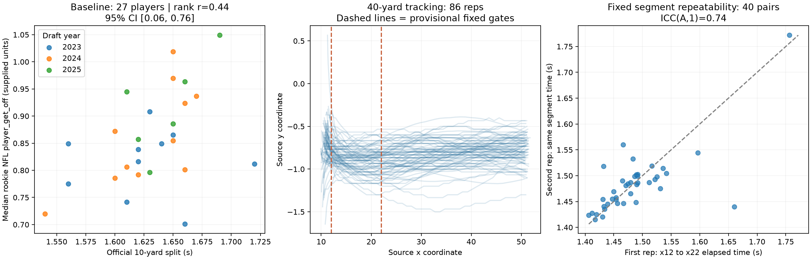

# Official 10-yard baseline and tracked-40 audit

Run `.venv/bin/python exploratory_scripts/edge_forty_audit.py` from the repository
root. Defaults: `--min-snaps 20 --bootstrap 2000`; deterministic seed 2027.

## Baseline finding

Of the existing 60 retained EDGE candidates, 47 have a supplied official
`ten_yd_split`; **27** also have at least 20 observed, nonnegative rookie NFL
get-off values on qualifying passing plays. These include 10 players from 2023,
11 from 2024 and six from 2025.

| Comparison | Player count | Rank correlation | Player-bootstrap 95% interval |
| --- | ---: | ---: | ---: |
| Official 10-yard split vs median NFL get-off | 27 | 0.440 | [0.057, 0.762] |
| Same, subtracting draft-year means from global ranks | 27 | 0.416 | [0.055, 0.725] |

The positive sign means faster official splits tend to accompany lower supplied
NFL get-off values. Removing one player at a time gives raw correlations
0.384–0.557 and year-adjusted correlations 0.348–0.527. This is evidence of an
association in a small, selected sample, not established predictive performance.
The wide intervals matter. No confidence interval accounts for all measurement,
selection, team/scheme, body-size, or alignment-depth uncertainty.

Outcome filters match the earlier analysis: rookie season, regular season,
non-nullified plays, `lined_up_position == EDGE`, pass result C/I/IN/S/R,
finite nonnegative supplied `player_get_off`. Each player gets equal weight
after summarizing by median; bootstrap resamples players within draft year.
Missing outcome values are not imputed. Both official split and NFL coverage
are retained for every cohort member in the player export. Official split
values are player-level results, not mapped to particular tracked attempts.

## Tracking audit

There are **86 tracked 40-yard recordings from 46 players**, with **40 repeated
players** and six single-recording players. All 86 have finite x/y/s values and
uninterrupted 0.1-second timestamps. All cover the fixed early course gates.
One recording (Kyle Kennard's first) has a small reverse x step before x=12;
it is flagged in the export but does not reverse inside the scored segment,
so it is retained. No other course quality exclusion is triggered.

No recording begins below speed 0.2. Initial supplied speed ranges from 0.263
to 1.383. This means a stationary pre-start baseline is not captured at the
recording start under that threshold; it does not establish the true start
time. Median initial x varies across cohorts: 10.833 in 2023, 11.133 in 2024,
and 10.205 in 2025. Recording-start-aligned acceleration can therefore mix
different phases or locations.

Median final x is about 51 in all years, and net travel is about 40 source
coordinate units. Median ratio of coordinate-derived forward speed to supplied
speed is 1.001–1.002 by year. This supports internal consistency and is
consistent with yard-like coordinates and speed units per second. The official
Combine dictionary was not readable through the web tool, so this remains an
inference rather than verified unit metadata. Negative y values describe this
drill's supplied lane coordinates, not a reconstructed field diagram.

We use fixed x=12→22 elapsed time as the primary tracking candidate, chosen
to be bracketed by all recordings and independent of NFL outcomes. A fixed
x=13→23 segment is a location sensitivity check. We also measure supplied
speed gain and mean speed change per second between x=12 and x=17. Gate
crossing times and speeds are linearly interpolated between 10 Hz observations.
Interpolation does not create millisecond measurement accuracy. These are
early moving course segments, **not official 10-yard splits, acceleration from
rest, or cue reaction times**. Body-tag coordinates need not correspond to
official start/finish triggers.

## Repeatability

Compare each player's first two usable records chronologically, not source
attempt numbers. ICC is absolute-agreement ICC(A,1); intervals resample paired
players. No feature is selected based on an NFL outcome correlation.

| Candidate | Pairs | ICC | 95% interval | Median absolute paired difference |
| --- | ---: | ---: | ---: | ---: |
| x12→22 elapsed time | 40 | 0.736 | [0.158, 0.950] | 0.013 s |
| x13→23 elapsed time | 40 | 0.744 | [0.396, 0.894] | 0.014 s |
| x12→17 speed gain | 40 | 0.690 | [0.508, 0.794] | 0.262 source speed units |
| x12→17 mean speed change per second | 40 | 0.643 | [0.394, 0.794] | 0.259 source speed units/s |

The x12→22 ICC is sensitive to individual players: leave-one-player-out ICCs
range from 0.445 to 0.878. The corresponding range for x13→23 is 0.619–0.815.
Mohamed Kamara has a consistently slow segment in both reps and substantially
increases between-player variation; Eric Watts has a large paired discrepancy
(about 0.220 s for x12→22). Neither is removed based on these results. Inspect
their full records and compare alternative gate positions before declaring a
validated player trait. Location sensitivity is substantive evidence about the
measurement, not a reason to choose whichever ICC is largest.

## What this supports

**Starting-location sensitivity is a material concern.** Across 46 player
medians, recording-start x has rank correlation 0.637 with x12→22 time and
0.342 with x13→23 time. For example, Kamara starts near x=11.5–11.6 and crosses
x=12 at supplied speed 1.70–1.97; Watts crosses x=12 at speed 1.58 in one rep
and 3.08 in the other. A common x gate is not necessarily the same movement
phase or distance from each player's true start. Stance, tag offset, recording
crop and genuine acceleration differences cannot yet be disentangled. Stable
start-location effects can inflate a repeatability statistic; ICC alone is not
validation. Both raw and draft-year-adjusted start correlations are exported.
The issue is stronger for x12→17 speed gain: its player-level correlation with
recording-start x is 0.943 (0.861 after draft-year adjustment). Thus the current
fixed-gate acceleration candidates should not be promoted as calibrated player
traits despite their positive repeatability estimates.

This pivot has a clearer official baseline and more promising repeated
measurements than the original pass-rush feature. The tracking gate definition
still requires start-location calibration. **This work does not yet
show that tracking adds information beyond the official 10-yard split.** Only
26 players have both baseline eligibility and fixed-gate tracking coverage.
A fair added-value comparison must use that common sample for both models,
predefine one tracking feature, check the unusual paired records, establish
course/gate interpretation, and evaluate predictions outside the training sample.
NFL starting depth and team context also remain unadjusted.

The cohort is deliberately the same pass-rush-derived cohort, with the six
interior-majority exclusions. Thus this is not every possible EDGE prospect
with a tracked 40. Interior-role classification uses all available supplied NFL
seasons, including later role information for some players; it is not a
prospective Combine-only cohort. Ten provisional candidates lack qualifying
regular-season role observations. The exact NFL competition-field definition
and possible value censoring remain unresolved as documented in the earlier
[get-off methods](edge_get_off.md).

## Outputs and checks

Generated in `data/`: `edge_ten_yard_baseline_associations.csv`,
`edge_forty_attempts.csv`, `edge_forty_players.csv`, `edge_forty_pairs.csv`,
`edge_forty_repeatability.csv`, `edge_forty_geometry.csv`, and
`edge_forty_audit_summary.txt`, plus `edge_forty_start_sensitivity.csv`.
The pairs table includes player names and
absolute differences for review. Plot: `figures/edge_forty_audit.png`.

Checks exercised gate interpolation, unbracketed crossings, invalid timestamps,
cohort exclusions, baseline rank calculation, player medians, and repeated-pair
counts. Existing pass-rush metrics and correlation files are not overwritten.

For physical context, the NFL's [40-yard activity description](https://static.www.nfl.com/image/upload/league/lvb7m66cl3yszivyww4q.pdf)
describes a straight course with markers every ten yards. It does not establish
the tracking origin or electronic timing trigger locations used here.
