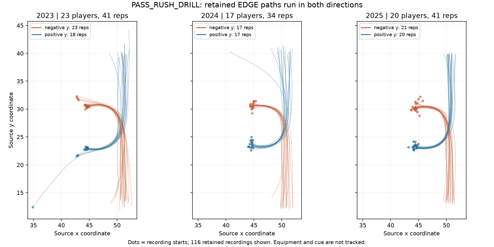

# PASS_RUSH_DRILL setup audit

## Finding

All 55 players with multiple recordings in the filtered EDGE cohort cover
both mirrored path directions. Both paths initially move toward increasing
x, then bend toward opposite y directions. These are source-coordinate labels,
not independently verified defensive-left/defensive-right assignments.

## Rep structure

Filter `drill_name == PASS_RUSH_DRILL` and `entity_type == PLAYER`; join roster
on `nfl_id`. A recording is `(nfl_id, event_id, attempt)`, sorted by time.
The full drill has 225 recordings for 118 players. The initial DE/OLB proxy has
126 recordings for 66 players; excluding six primarily interior players leaves
116 recordings for 60 players. See the [cohort review](edge_pass_rush_cohort.md)
for alignment-based exclusions and provisional inclusions. All 116 retained
recordings have uninterrupted 0.1-second timestamps. Direction is
the sign of final minus initial y, requiring absolute displacement of at least
10 source units. No current recording is ambiguous under that rule. This labels
the overall path, not body stance or every instantaneous movement.

| Year | Players | Recorded reps | Negative-y paths | Positive-y paths |
| --- | ---: | ---: | ---: | ---: |
| 2023 | 23 | 41 | 23 | 18 |
| 2024 | 17 | 34 | 17 | 17 |
| 2025 | 20 | 41 | 21 | 20 |

Five players have one recorded rep, 54 have two, and Nic Scourton has three.
All 54 two-rep players have opposite-direction paths. Scourton has negative-y
attempts 3 and 4 followed by positive-y attempt 5. Missing recordings do not
establish that a player performed only one rep at the Combine.

Attempt numbers cannot safely identify side:

- 2023: attempt 1 has 23 negative-y recordings, attempt 2 has 18 positive-y recordings.
- 2024: attempt 1 has 17 negative-y recordings; attempt 2 has 17 positive-y
  recordings. The initial proxy's two positive-y attempt-1 players are excluded.
- 2025: attempt 3 has 19 negative-y recordings; attempt 4 has two negative-y
  and 18 positive-y recordings; attempt 5 has two positive-y recordings.
  Princely Umanmielen has attempts 4 and 5, one in each direction.

## Geometry and footage

DL-session median recording starts are approximately x=44.4–44.7,
y=30.2–30.7 for negative-y paths, and x=44.4–44.5, y=22.9–23.6 for
positive-y paths. Players move toward x around 50, bend, and finish mostly
around y=12–14 or y=40–41. These are tracking coordinates, not surveyed bag
positions, a line-of-scrimmage definition, or measured drill distances. Units
remain unverified against the official Combine dictionary.

[NFL's official 2024 Latu workout video](https://www.youtube.com/watch?v=-lMFW_3rpYw&t=55s)
shows a stance start and upright bags held by kneeling assistants around
0:55–1:00, including a transition from Kneeland to Latu. This edited segment
does not independently match every tracked rep, show both versions completely,
establish exact bag count/spacing or prescribed hand technique across years,
or identify the cue frame. The source also contains separate
`RUN_THE_HOOP_DRILL` and `RUN_AND_CLUB_DRILL` labels; keep those separate.
The official [competition data page](https://www.kaggle.com/competitions/nfl-big-data-bowl-2027/data)
was not readable through the web tool during this review.

The 2023 LB session differs: eight recordings from Will Anderson, Yasir Abdullah,
Lonnie Phelps, and Tyrus Wheat start around x=42.8 rather than 44.5 and generally
have longer net paths. Retain session type until video establishes comparable
start-to-contact geometry.

## Next steps for get-off

1. Maintain the [alignment-based cohort](edge_pass_rush_cohort.md). Six players
   with primarily interior NFL usage are now excluded. Ten retained players
   without qualifying alignment observations still need independent role review.
2. Review video from each year, both directions, and DL/LB sessions. Annotate
   set stance, cue if visible, actual rush onset, and first bag contact; match
   those phases to tracking. Exact equipment spacing and cue remain unresolved.
3. Separate preparatory motion from the set rush. Tyrus Wheat's second
   recording lasts 10.2 seconds and starts far from the main cluster. Justin
   Eboigbe's 9.1-second recording was removed by the role exclusion. Four retained
   recordings already begin above the existing speed threshold. Inspect these
   before scoring get-off.
4. Retain direction/session labels and mirror verified rush segments into a
   shared frame. Evaluate short post-onset speed/displacement and, once units
   are confirmed, time to a fixed early distance. Confirm that windows end
   before contact when the intended construct is initial burst.
5. Evaluate onset/window sensitivity and agreement across sides before linking
   to snap-aligned NFL movement. There is no explicit cue/snap annotation or
   tracked ball in this drill's supplied rows. Cue-to-movement reaction time
   requires an independently aligned cue; movement-aligned burst does not.

The filtered 52 usable pairs include 51 opposite-direction pairs and one
same-direction pair (Scourton). ICC=0.058 primarily describes agreement across
mirrored reps with onset/phase uncertainty, not clean same-side test-retest
reliability. Direction and chronological order are largely confounded, so the
sample cannot isolate a pure side effect.

## Reproduction

Run `.venv/bin/python exploratory_scripts/edge_pass_rush_setup.py` after the
existing onset audit. Outputs:

- `data/pass_rush_setup_attempts.csv`: all 225 recordings with geometry,
  direction, timestamps, session, and both initial-proxy and retained-cohort indicators.
- `data/edge_pass_rush_setup_players.csv`: recorded direction sequences.
- `data/edge_pass_rush_direction_counts.csv`: year/attempt/direction counts.
- `data/edge_pass_rush_setup_geometry.csv`: median geometry by year/session/direction.
- `data/edge_pass_rush_setup_summary.txt`: counts and original-pair composition.
- `figures/edge_pass_rush_setup.png`: all 116 retained EDGE trajectories.

Original onset definitions and metric formulas are unchanged. Output tables
and figures have been regenerated for the filtered cohort.
