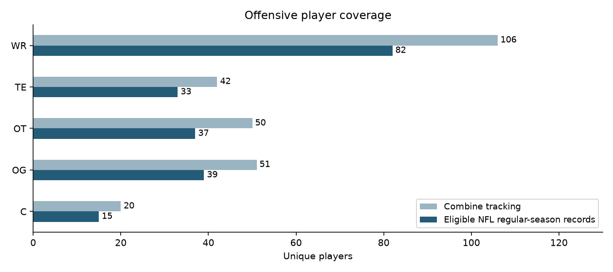
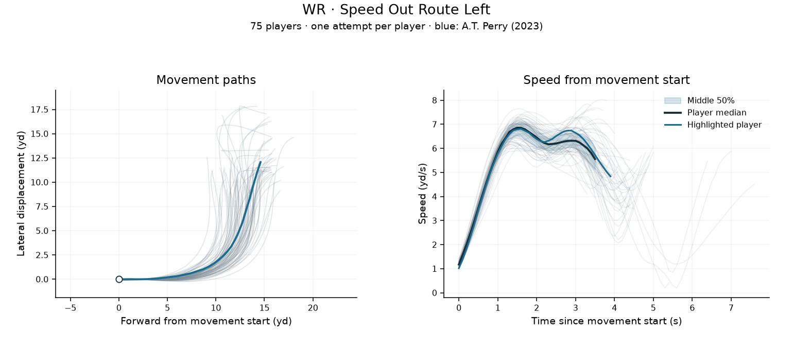
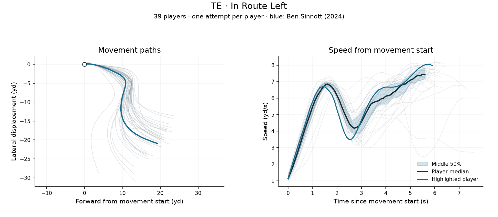
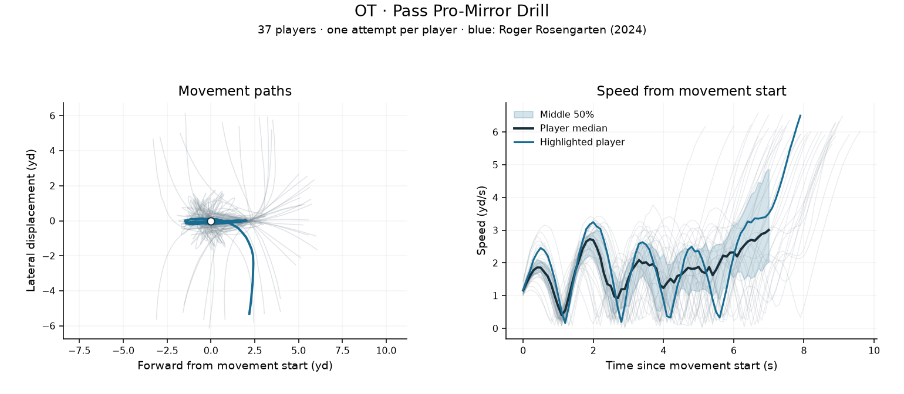

## Offensive Combine exploration

Selected figures for WR, TE, OT, OG and C. These are descriptive comparisons, not rankings or validated predictions of NFL performance. The full viewers, datasets and exploratory outputs are kept locally.

### Available players

Combine coverage includes any tracked drill. NFL coverage counts players with regular-season records on plays not nullified by penalty; participation in a particular drill or role can be lower.

### Wide receivers: speed-out route

Paths reveal differences in where players turn and how broadly they bend. Speed curves show acceleration and subsequent speed loss. These differences need drill-phase review before linking them to NFL separation.

### Tight ends: in route

Compare route shape and speed profiles among tight ends performing the same named drill. Recording length and movement after the route can affect the visible differences.

### Offensive tackles: mirror drill

Repeated speed rises and falls show short movements and reversals. The finishing run may dominate the path and peak speed; it should be separated from the mirror portion before assessing protection-related traits. This chart uses the exact source label `PASS_PRO-MIRROR_DRILL`; the alternate underscore label remains separate.

### Reading the comparisons

- Faint lines: one eligible attempt per player, selected nearest that player's median eligible duration.
- Blue line: an illustrative player with typical recorded duration, not the best performer.
- Dark line and shaded band: median speed and middle 50% of players. Summaries stop when fewer than 80% of players remain recorded.
- Movement begins at three consecutive frames at or above 1 yard/second. Paths share a starting point and are rotated to the initial two-yard displacement; left/right signs are preserved. This is travel direction, not body orientation.
- Full recorded exits remain included. Comparisons are within exact drill labels and positions, with no claim that protocols are identical across years.

Raw tracking data, CSV exports and the large website are not part of this repository view. No GitHub Pages setup is needed to view these figures.
