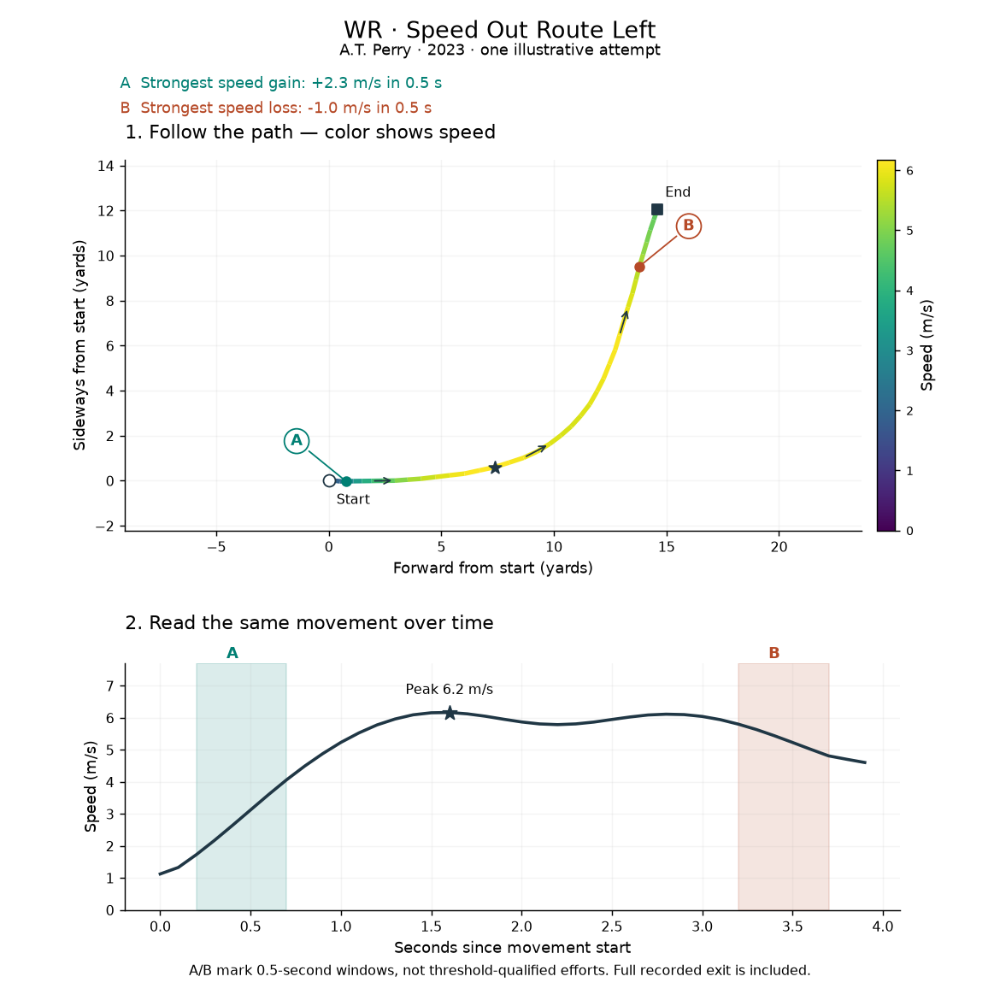
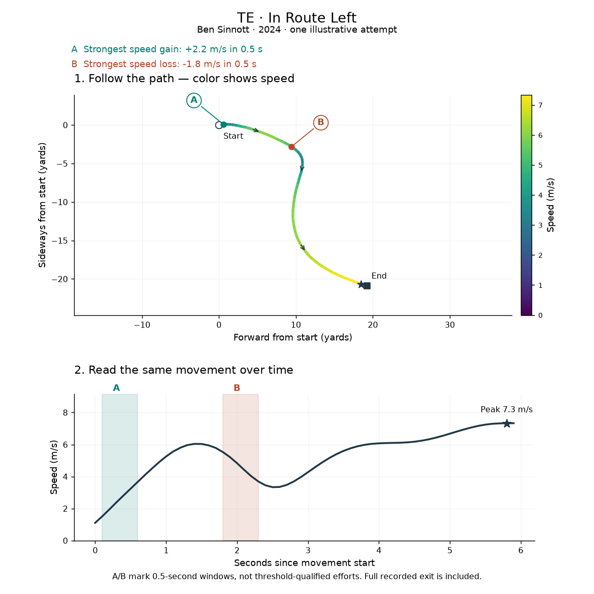
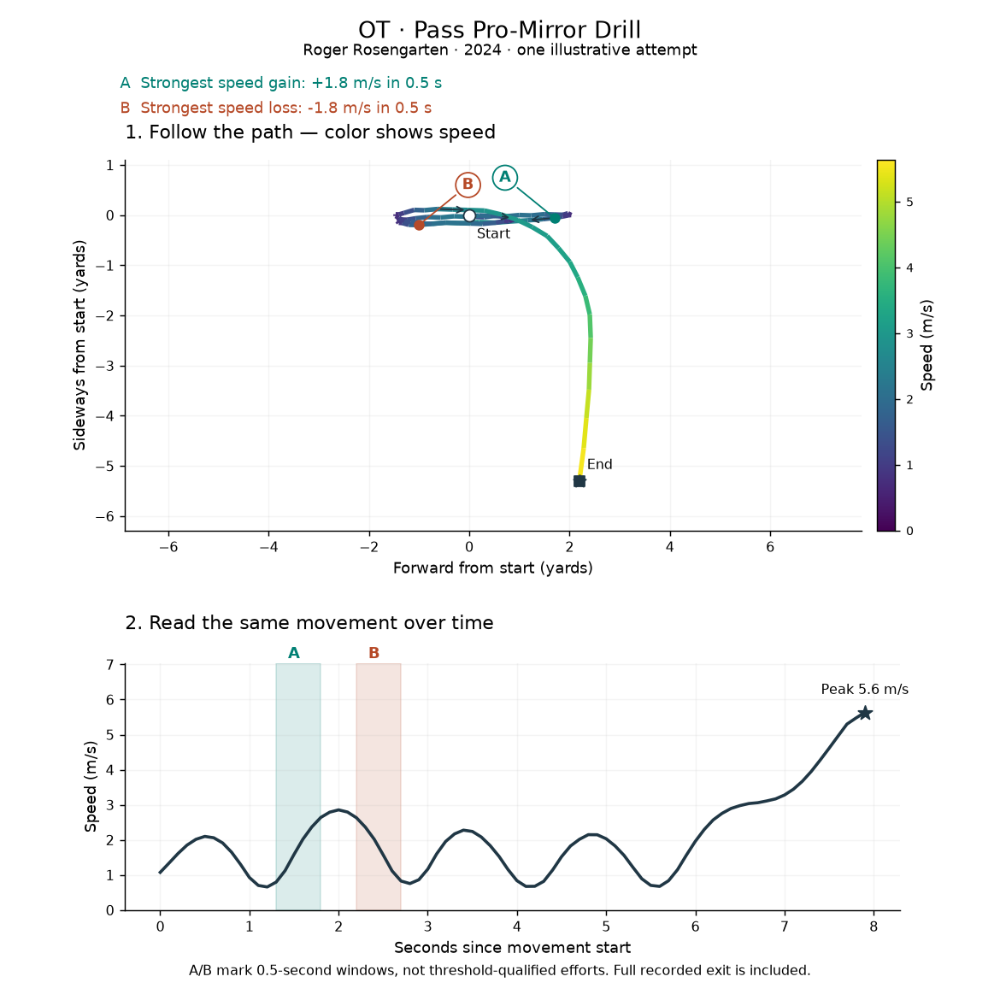

## Offensive Combine exploration

Selected figures for WR, TE, OT, OG and C. These are descriptive comparisons, not rankings or validated predictions of NFL performance. The full viewers, datasets and exploratory outputs are kept locally.

### Available players

Combine coverage includes any tracked drill. NFL coverage counts players with regular-season records on plays not nullified by penalty; participation in a particular drill or role can be lower.

### Wide receivers: speed-out route

**A.T. Perry — speed-out route.** Follow the speed-colored path above, then match A and B to the shaded windows on the speed curve.

**Comparison across players:**

Paths reveal differences in where players turn and how broadly they bend. Speed curves show acceleration and subsequent speed loss. These differences need drill-phase review before linking them to NFL separation.

### Tight ends: in route

**Ben Sinnott — in route.** Follow the speed-colored path above, then match A and B to the shaded windows on the speed curve.

**Comparison across players:**

Compare route shape and speed profiles among tight ends performing the same named drill. Recording length and movement after the route can affect the visible differences.

### Offensive tackles: mirror drill

**Roger Rosengarten — mirror drill.** Follow the speed-colored path above, then match A and B to the shaded windows on the speed curve.

**Comparison across players:**

Repeated speed rises and falls show short movements and reversals. The finishing run may dominate the path and peak speed; it should be separated from the mirror portion before assessing protection-related traits. This chart uses the exact source label `PASS_PRO-MIRROR_DRILL`; the alternate underscore label remains separate.

### Reading the individual movement examples

- Path color shows smoothed speed; arrows show travel direction. The star marks peak smoothed speed.
- A marks the strongest speed gain over 0.5 seconds; B marks the strongest speed loss over 0.5 seconds. The same windows appear on the speed curve below.
- These are illustrative attempts, not top-performer selections. A/B are descriptive windows, not the duration-qualified effort counts used in the metric analysis.
- Paths use yards; speed uses meters/second. Start is detected movement onset and End is the recording endpoint. The strongest speed change can occur during the drill exit rather than the intended cut.

### Reading the all-player comparisons

- Faint lines: one eligible attempt per player, selected nearest that player's median eligible duration.
- Blue line: an illustrative player with typical recorded duration, not the best performer.
- Dark line and shaded band: median speed and middle 50% of players. Summaries stop when fewer than 80% of players remain recorded.
- Movement begins at three consecutive frames at or above 1 yard/second. Paths share a starting point and are rotated to the initial two-yard displacement; left/right signs are preserved. This is travel direction, not body orientation.
- Full recorded exits remain included. Comparisons are within exact drill labels and positions, with no claim that protocols are identical across years.

Raw tracking data, CSV exports and the large website are not part of this repository view. No GitHub Pages setup is needed to view these figures.
